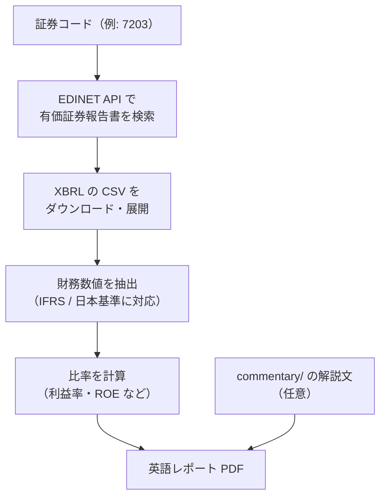

# edinet-report-tool

日本の上場企業の**証券コード**から、金融庁 EDINET の有価証券報告書（XBRL）を自動で取得し、**英語の財務レポート（PDF）**を作る Python ツールです。
**証券コードを変えるだけで、EDINET に有価証券報告書を提出している企業なら、どの企業でも同じ形式のレポートを出力できます**（対応範囲は下の「対応範囲と制限」を参照）。
さらに、上場銘柄を条件で絞り込む「スクリーニング」と、選んだ企業を比較するテーマレポートの生成コードも含みます。

A Python tool that takes a Japanese securities code, pulls the company's annual securities reports (XBRL) from the FSA's EDINET system, and builds an English-language financial report as a PDF.



## 構成
| ファイル | 役割 |
|---|---|
| `edinet_lib.py` | 共通ライブラリ。EDINET の検索・ダウンロード・XBRL 抽出・`.env` 読み込み |
| `generate_report.py` | 証券コードを指定して英語レポート PDF を作るメインのスクリプト |
| `step2_...` 〜 `step16_...` | 作りながら試した段階ごとのスクリプト（接続確認、CSV の中身調査、グラフ、PDF など） |
| `check_*.py`, `extract_policy.py` | XBRL のタグや本文を調べるための補助スクリプト |
| `screening/` | 上場銘柄の絞り込み（J-Quants + EDINET）と、候補企業の深掘り |
| `screening/config.py` | 絞り込み条件（市場区分・業種・時価総額の範囲） |

## 必要なもの
- Python 3.13（動作確認した版）
- EDINET API キー（無料。EDINET の公式サイトで取得）
- J-Quants API キー（`screening/` を使う場合のみ）

## セットアップ
```bash
git clone <このリポジトリ>
cd edinet-report-tool
python -m venv venv
venv\Scripts\activate
python -m pip install -r requirements.txt
copy .env.example .env   # 値を各自の環境に合わせて書き換える
```
`.env` には API キーを書きます。`.env` は `.gitignore` で除外されているため、公開されません。

## 使い方

### 1社の英語レポートを作る
```bash
python generate_report.py 7203
```
証券コード（4桁）を指定すると、直近5期分の有価証券報告書を自動で探して取得し、`output/` に `7203_report.pdf` を作ります。
`commentary/<証券コード>_overview.txt` と `commentary/<証券コード>_risks.txt` を置くと、その文章が「Business Overview」「Risks & Outlook」の節に入ります（置かなければ空欄のまま）。

別の企業を出したいときは、証券コードを入れ替えるだけです。

```bash
python generate_report.py 6758
```

### 対応範囲と制限
| 項目 | 内容 |
|---|---|
| 対応する企業 | EDINET に有価証券報告書を提出している企業（上場企業が中心） |
| 対応する会計基準 | IFRS、日本基準（J-GAAP）。どちらかは自動で判定します |
| 対応していないもの | 米国基準など別の会計基準の企業、銀行・保険など科目の体系が異なる業種 |
| 数値が取れなかったとき | 止まらずに、レポートに「Data Completeness Warning」として表示します |
| 単体決算の会社 | 連結の数値がない場合は、単体の数値で代用します |

企業ごとに科目の付け方が違うため、出力された数値は原本（EDINET 上の有価証券報告書）と見比べて確認してください。

### 銘柄を絞り込む（screening）

```bash
python screening/step1a_fetch_master.py
python screening/step1b_filter_market_sector.py
python screening/step1b_marketcap.py
python screening/step1c_extract_edinet.py
python screening/step1d_score_output.py
```
絞り込み条件は `screening/config.py` で変えられます。

## データについて
- 財務数値は、EDINET に提出された有価証券報告書の XBRL から機械的に取り出したものです。
- EDINET・J-Quants から取得したデータ（`data/`、`screening/output/`）と、生成した PDF・画像（`output/`、`outputs/`）はこのリポジトリに含めていません。
- J-Quants のデータは再配布できない規約のため、手元で取得して使ってください。
- 生成されるレポートは情報の整理を目的としたもので、投資助言ではありません。

## 注意
- `.env` や API キーは絶対にコミットしないでください。
- EDINET API は、利用が集中する時間帯に応答が遅くなることがあります。

## 著作権・利用について
© 2026 onuma-h. All rights reserved.

このリポジトリは閲覧・参考のために公開しています。
コードの複製・改変・再配布・その他の利用には、作者の許可が必要です。
本コードの利用によって生じたいかなる損害についても、作者は責任を負いません。
